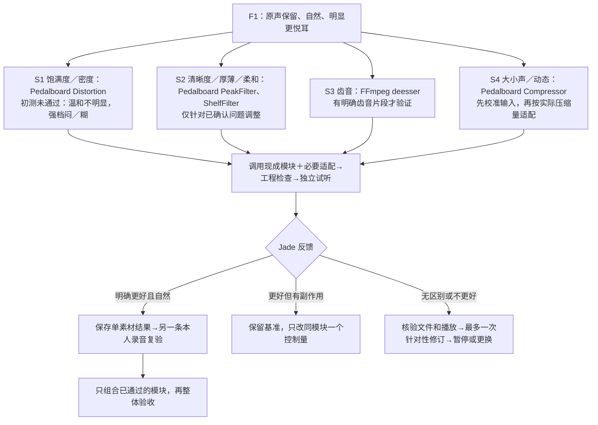

# F1 功能锚定图

> **2026-11-03：本文件为历史记录，现行路线与规则见 [docs/ROADMAP.md](ROADMAP.md) 与根目录 AGENTS.md。**

> 2026-10-27：本页为历史功能图。当前主线是 [自适应V0](../f1_adaptive_v0/README.md)，旧路线收尾见 [新基线登记](F1_REBASE_2026-10-27.md)。下列状态保留历史原文。

状态：S1 初测未通过听感验收：温和档收益不明确，较明显档明显闷、略糊；没有接受的版本，不进入组合。其他节点未验收、不自动常开。
验收目标来自项目需求 v1.2；最终标准仍是 Jade 明显偏好处理版且自然、像本人。
每维度“原音有什么问题、应该听见什么、不接受什么”及失败动作见 [可听验收标准](F1_LISTENING_ACCEPTANCE.md)。先确认素材有对应问题，才选模块。

## 可复用项目与适配卡

| 功能 | 项目与具体模块 | 值得参考的操作流程 | 本项目适配 | 主要风险与状态 |
|---|---|---|---|---|
| S1 饱满度／声音密度 | Spotify Pedalboard `Distortion` | 创建插件→设置 drive→处理浮点音频→导出 | 活跃演唱电平归一；处理后增益补偿；少量原音/处理音混合；统一响度 | 初测未通过：温和收益不明，强档闷糊。候选不进入组合，建议暂停；该功能仍未解决 |
| S2 清晰、柔和与频谱平衡 | Pedalboard `PeakFilter`、`LowShelfFilter`、`HighShelfFilter` | 单个滤波器处理、逐项旁路比较 | 对具体问题频段做有限调整；不照抄男女声同一参数 | 旧固定 EQ 多次无稳定收益，不以更换库当作改善；待明确问题后复用 |
| S3 齿音 | FFmpeg `deesser` | 阅读官方参数→单项 WAV 处理→在齿音片段比较 | 参数与采样率核验，按素材选择是否启用 | 无突出齿音不默认开；过量会含混；未验证 |
| S4 动态稳定 | Pedalboard `Compressor` | 统一输入电平→设置阈值/比率/起音/释放→比较动态 | 输入强弱适配、输出固定增益对照；同时记录实际作用 | 不因最终 LUFS 一致就认为处理程度一致；可能抽吸、抬呼吸或压情绪；未验证 |
| 共同工程支撑 | 现有 `f1_poc.py` 的 WAV、响度、导出与诊断 | 复用文件接口与重新读取实际产物 | 单元模块输出统一 PCM WAV，所有比较校准响度 | 共同支撑不是额外美化功能，技术通过不等于主观通过 |

“悦耳”是综合验收，不锚定单一旋钮。自然度、本人音色、情绪与咬字是所有节点的约束。

## 当前不纳入主链

- SRS：官方定位是受损歌声恢复，与当前较干净清唱的 F1 不完全匹配，留作有明确损伤证据后的候选；不默认降噪。
- NeuralSVB：目标有关联，但官方原始音频直接推理仍 WIP，F1 单独接入尚未确认，当前不投入复杂重合成。
- 音高修正、节奏、混响、人声分离、伴奏：不借美化名义混入 F1。
- REAPER：可留作诊断工具；不要求 Jade 先学习专业调音。

## 第一轮交付与反馈

- 主素材：`test_dataset/my_singing/shige_medium.wav`，本人中度录音；原始唱准问题保留。
- 原音 + 两档 S1 候选，只有一个模块；不调用旧 EQ、压缩或去齿音。
- 低档与高档只是实验强度，不代表更强更好。不承诺饱满度一定提高。
- Jade 只需反馈：偏好原音/温和/较明显/无区别；是否更充实；有无毛、硬、闷、压住或不像本人。
- 初次反馈已收到，见 experiments/F1_S1_density_v001/feedback.json 与 feedback_review.md；没有通过版本，未继续生成修订音频。
- 反馈分支及停止条件以根目录 AGENTS.md 为准。

## 来源

- 官方项目：https://github.com/spotify/pedalboard （GPL-3.0；部署/分发时另行核验集成义务）。
- 官方 API：https://spotify.github.io/pedalboard/reference/pedalboard.html#pedalboard.Distortion
- 滤波器、Compressor：同一份官方 API；可查确切参数，不复制陌生实现。
- FFmpeg 去齿音：https://ffmpeg.org/ffmpeg-filters.html#deesser （本地 ffmpeg -h filter=deesser 可核验构建能力）。
- SRS：https://github.com/smulelabs/smule-renaissance
- NeuralSVB 正确仓库：https://github.com/MoonInTheRiver/NeuralSVB
- 旧调研的轻谐波增强建议作为选题线索；是否有效以本项目试听决定。
